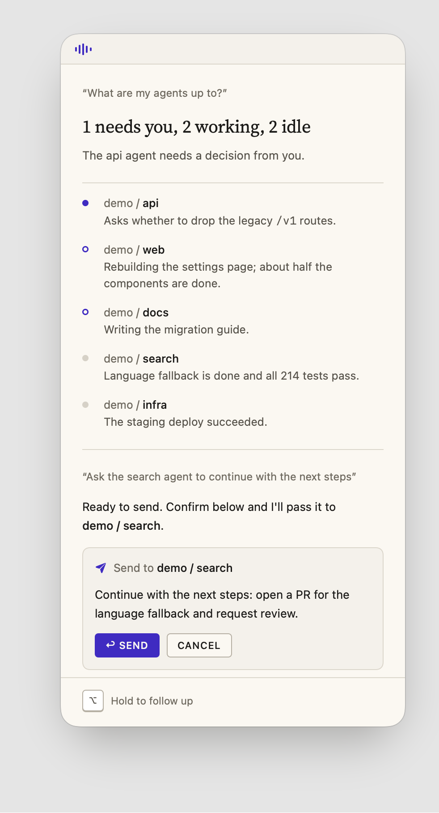
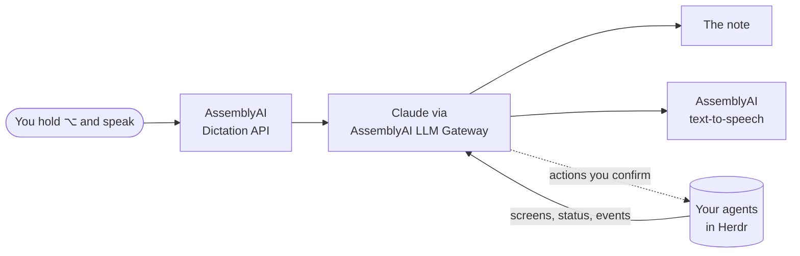
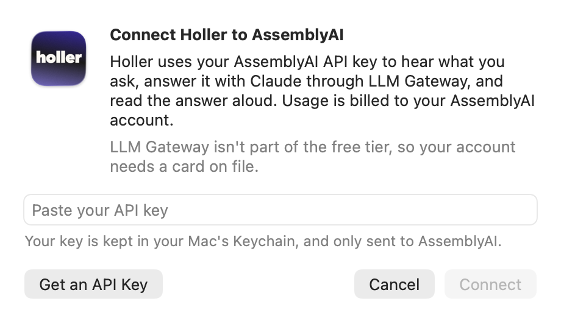

<p align="center">
  
</p>

<h1 align="center">Holler</h1>

<p align="center">
  <strong>Hold a key and ask your coding agents what they're up to.</strong><br>
  A macOS menu-bar voice assistant for the agents running in <a href="https://herdr.dev">Herdr</a>, built on <a href="https://www.assemblyai.com">AssemblyAI</a>.
</p>

<p align="center">
  <a href="https://github.com/markthompson-aai/holler/actions/workflows/ci.yml"></a>
  
  <a href="LICENSE"></a>
</p>

<p align="center">
  <picture>
    <source media="(prefers-color-scheme: dark)" srcset="docs/images/send-dark.png">
    
  </picture>
</p>

You've got five agents working in five tabs. One finished ten minutes ago, one has been waiting on a question, and you're in the middle of something else. Hold **right ⌥**, say *"what are my agents up to?"* and let go. Holler reads every agent's screen and answers in a small note: who needs you, who's working, and what each one has done. It reads the answer aloud too, so you can keep your eyes on your own work.

Then keep going without touching the keyboard:

- *"Ask the search agent to open a PR for it."*
- *"Start a Codex agent in the web project to add a dark mode toggle."*
- *"Stop the api agent."*
- *"Take me to the one that needs me."*
- *"Tell me when the docs agent finishes."*
- *"What's changed since I last asked?"*

Nothing reaches an agent until you confirm it on screen, unless you've switched on the [countdown for simple actions](#using-holler).

## How it works



1. While you hold the hotkey, Holler streams your voice to AssemblyAI's [Dictation API](https://www.assemblyai.com/docs/dictation), which returns a cleaned-up transcript. It reads your agents' screens from Herdr at the same time, so nothing waits on them.
2. The transcript and the screens go to Claude through [LLM Gateway](https://www.assemblyai.com/docs/llm-gateway/quickstart). Claude can read more of an agent's output, and can queue actions, but it never gets a shell: its eight tools are listed under [Privacy and safety](#privacy-and-safety).
3. The answer appears in the note and is spoken with AssemblyAI's [text-to-speech](https://www.assemblyai.com/docs/tts/getting-started/quickstart), streamed so it starts about half a second after the answer appears.

A summary usually comes back 3 to 4 seconds after you let go of the key.

## Requirements

- macOS 26 or later.
- Swift 6.2, from Xcode 26 or the Command Line Tools (`xcode-select --install`). Holler builds without Xcode.
- [Herdr](https://herdr.dev), the terminal multiplexer for coding agents, with your agents running in it. Herdr runs inside whichever terminal app you like (Ghostty, iTerm2, Terminal), and Holler brings that app forward when you jump to an agent. Tested with Herdr 0.9.
- An [AssemblyAI](https://www.assemblyai.com/dashboard/signup) account with a card on file. Holler uses LLM Gateway, which isn't part of the free tier, and every request is billed to your account. Holler talks to AssemblyAI's US endpoints, so an API key created for the EU region may not be accepted.

Holler starts Claude Code or Codex agents when you ask it to, so have whichever you use installed.

## Install

Holler isn't notarized yet, so for now you build it yourself. It takes a minute or two.

```sh
git clone https://github.com/markthompson-aai/holler.git
cd holler
scripts/build-app.sh
cp -R build/Holler.app /Applications/
open /Applications/Holler.app
```

To have it start when you log in, add it in **System Settings › General › Login Items**.

## Updating

Quit Holler from its menu, then build the new version and put it in place of the old one:

```sh
cd holler
git pull
scripts/build-app.sh
rm -rf /Applications/Holler.app
cp -R build/Holler.app /Applications/
open /Applications/Holler.app
```

A build you make yourself is signed ad hoc, and macOS treats each one as a different app from the last. So after an update:

- macOS asks for the microphone again.
- The hotkey stops working until you allow Input Monitoring again. If Holler is already switched on in **System Settings › Privacy & Security › Input Monitoring** and the hotkey still does nothing, remove Holler from that list with **−**, open it again and switch it back on.
- The Keychain asks whether the new build may read your API key. Choose **Always Allow**.

To keep all three across rebuilds, create the **Holler Dev** signing certificate once, as [CONTRIBUTING.md](CONTRIBUTING.md#keeping-permissions-across-rebuilds) describes. The build script uses it from then on.

## First run

<picture>
  <source media="(prefers-color-scheme: dark)" srcset="docs/images/api-key-dark.png">
  
</picture>

1. **Connect your AssemblyAI API key.** Holler asks for it the first time it opens. Copy a key from your [AssemblyAI dashboard](https://www.assemblyai.com/dashboard/api-keys) and paste it in. Holler checks it with AssemblyAI before saving it, then keeps it in your Mac's Keychain. You can change it any time from **Menu bar › AssemblyAI API Key…**.
2. **Allow the microphone** when macOS asks. If you chose Don't Allow, Holler says so in the note and at the top of its menu; switch it on in **System Settings › Privacy & Security › Microphone**.
3. **Allow Input Monitoring**, which the hotkey needs: in **System Settings › Privacy & Security › Input Monitoring**, switch Holler on. Holler notices within a couple of seconds, with no need to relaunch.
4. **Hold right ⌥ and ask** *"what are my agents up to?"*

If Holler can't find Herdr, it says so and links to [herdr.dev](https://herdr.dev). Install it, then choose **Reload Settings** from Holler's menu.

## Using Holler

| | |
|---|---|
| **Hold the hotkey** | Ask. While the note is open, holding it again asks a follow-up in the same conversation. You can also cut in while Holler is still thinking. |
| **Tap the hotkey** | Close the note. Holler remembers the conversation for 20 minutes, so you can ask *"is it done yet?"* a minute later without saying which agent. |
| **Return** | Confirm the newest card (its button shows **↩**). |
| **Esc** | Close the note and drop its card, while a card has the keyboard (its button shows **↩**). At any other time Esc is left to the app you're in. |
| **Click an agent's row in a summary** | Jump to that agent in Herdr. |

The note opens the moment you let go of the key, with a row per agent and how long each has been working or waiting, before the answer is in. The answer then takes their place.

**What you can ask**

- **Summaries**: *"What are my agents up to?"*, *"What do I need to act on?"*, *"Talk me through the api agent"*, *"Explain what the docs agent changed."*
- **Messages**: *"Tell the search agent to run the tests."* A card shows the exact message; nothing is sent until you click **Send** or press Return. *"Actually, tell it to open the PR as a draft"* replaces the card, and *"and also…"* adds a second one.
- **New agents**: *"Start a new agent in the web project to add a dark mode toggle."* Holler opens a tab in that workspace, starts Claude Code (or Codex, if you ask for it) and hands it the task. Ask for a worktree (*"start Claude in a worktree of the web project to try the cache fix"*) and it gets its own git checkout on a new branch.
- **Interrupts**: *"Stop the api agent"* sends it Esc, as if you'd pressed it in its terminal.
- **Closing tabs**: *"Close the dark-mode tab"* works only for tabs Holler started itself.
- **Jumps**: *"Show me the api agent"* switches Herdr to it and brings the terminal forward. A jump only moves your view, so it doesn't wait for a card.
- **Alerts**: *"Tell me when the docs agent finishes"* shows a quiet note when that agent stops working, even after you've closed the note.
- **What changed**: *"What's changed since I last asked?"* lists status changes, with times, and what's new on each working agent's screen.

**The menu bar** shows Holler's mark, with a count beside it when agents are waiting on you. Its menu includes:

- **Summarise My Agents** and **Type a Question…**, to ask without speaking.
- **Reopen Last Note** and **New Conversation**.
- **Read Answers Aloud**, on by default. Say *"just show me"* to keep one answer silent, or *"read it to me"* to hear one while it's off.
- **Run Simple Actions Without a Card**, off by default. When it's on, a message to an idle agent or a new agent in a new tab goes after a 3-second countdown you can cancel, rather than waiting for a click. Everything else still waits for you. [ADR 0001](docs/adr/0001-simple-actions-run-after-a-countdown.md) explains why.
- **AssemblyAI API Key…** and **Reload Settings**.

[docs/reference.md](docs/reference.md) describes every gesture, request and action in full.

## Settings

Holler works without any settings file. To change the defaults, create `~/.config/holler/.env` from [`.env.example`](.env.example). If you built Holler from a clone, a `.env` at the root of that clone is used instead. Holler reloads the file when you save it.

| Setting | What it does | Default |
|---|---|---|
| `HOLLER_HOTKEY` | The key you hold: `right-option`, `right-command` or `fn` | `right-option` |
| `HOLLER_WORKSPACES` | Comma-separated Herdr workspaces Holler may see | all of them |
| `HOLLER_EXCLUDE_PATHS` | Colon-separated folders whose agents Holler never reads or messages, each an absolute path or starting with `~` | none |
| `HOLLER_MODEL` | The LLM Gateway model that answers | `claude-sonnet-5-5` |
| `HOLLER_EFFORT` | Claude's effort level: `low`, `medium`, `high`, `xhigh`, `max`, or `default` | `medium` |
| `HOLLER_VOICE` | The Mac voice to fall back on if AssemblyAI's voice can't be reached | the best one installed |
| `HERDR_PATH` | Where `herdr` is, if it isn't in one of the usual places | found on its own |
| `ASSEMBLYAI_API_KEY` | A key to use instead of the one saved in the Keychain | none |

If you use `fn` as the hotkey, set **System Settings › Keyboard › Press 🌐 key to** to **Do Nothing**, or macOS's own action runs on every press too.

**Why Sonnet 5.5?** In our tests it was the only model that got the headline counts right every time while staying fast: 3 to 4 seconds for a summary of six agents at medium effort. Smaller, faster models miscounted agents or put one agent's question under another. You can try any model LLM Gateway offers with `HOLLER_MODEL`.

## Privacy and safety

**What leaves your Mac**, all of it to AssemblyAI:

- Your voice, only while you hold the hotkey, to the Dictation API. With it go the names of the workspaces, tabs and folders of the agents Holler can see, as key terms, so that "the search agent" is heard right.
- Your request and the text on your agents' screens, to LLM Gateway, to answer it. With them go each agent's workspace, tab, folder and terminal title, and the tabs and folders of your workspaces.

Before anything goes to LLM Gateway, Holler replaces what looks like a secret with a marker such as `[redacted key]`. Redaction is best effort. It catches [the common shapes of keys, tokens and passwords](docs/reference.md#safety-model), and a secret in any other shape gets through, so to keep a folder's agents away from LLM Gateway altogether, list the folder in `HOLLER_EXCLUDE_PATHS`.
- The answer, to text-to-speech, to read it aloud.

Holler has no analytics or telemetry. It logs each request's timings to the macOS log on your Mac, never what you said. Besides your key in the Keychain, it keeps two small files in `~/Library/Application Support/Holler`: the tabs it started, and the last 500 status changes it has seen, so wait times carry on after a relaunch.

**What Holler can do to your agents.** The model never gets a shell. It has eight tools: `list_agents`, `read_agents`, `focus_agent`, `prompt_agent`, `start_agent`, `close_tab`, `interrupt_agent` and `tell_me_when`. A message is typed at an agent's prompt, though, so it can do whatever that agent would do with it: read the card before you confirm it.

- **Every action waits for you.** Sending a message, starting an agent, closing a tab and interrupting an agent are only queued. They run once you confirm the card, or after a countdown you didn't cancel if you've switched that on. When an action runs, Holler looks its target up again in a fresh Herdr snapshot, and refuses it if the target has gone, is hidden, or is no longer the agent on the card.
- **Approvals stay with you.** Holler never sends a message to an agent that's waiting on an approval, and Herdr refuses one too, so Holler can never approve anything on your behalf. It never sends Esc to an agent that's waiting on you either.
- **Holler only closes tabs it started**, and only while the agent it started is still in the tab.
- **Shell and slash commands always wait.** Claude Code and Codex run a message that starts with `!` as a shell command, and one that starts with `/` as a slash command, rather than reading it. Holler never sends one after a countdown: it waits on its card, which warns you what it is.
- **Commands run without a shell.** Holler runs `herdr` with literal arguments, so no shell on your Mac ever interprets a message. Only the agent it's sent to acts on it.
- **Screen text is treated as data.** The model is told never to follow instructions that appear on an agent's screen.
- **You choose what it sees.** `HOLLER_WORKSPACES` and `HOLLER_EXCLUDE_PATHS` hide agents completely: they're never read or sent anything, the model isn't told their tabs' names, and Holler won't start agents in an excluded folder. `HOLLER_WORKSPACES` limits which workspaces Holler sees, not where a new agent may work: in a workspace it can see, it can start one in any folder that isn't excluded.

The [full safety model](docs/reference.md#safety-model) lists every check behind each action.

## Command-line tool

The `holler` command shares the app's core, for scripting and testing. It reads `ASSEMBLYAI_API_KEY` from the environment, or from a `.env` in the current folder or above, or else from `~/.config/holler/.env`.

```sh
swift build
.build/debug/holler agents                          # the agents Herdr can see
.build/debug/holler ask "summarise my agents"
.build/debug/holler chat                            # a conversation, one request per line
.build/debug/holler ask "tell the search agent to continue" --dry-run
.build/debug/holler watch                           # follow Herdr's events as they happen
.build/debug/holler stats --since 24h               # where the app's time went, from its log
```

Actions from the command line ask `[y/N]` in the terminal before they run.

## Try it with a demo workspace

`scripts/demo-workspace.py --run` creates `~/holler-demo` and a Herdr workspace named `demo` with four Claude Code agents, each set up to land in a different state: one finishes, one keeps working, one asks you to choose between two fixes, and one waits for approval to run a script. Set `HOLLER_WORKSPACES=demo` so Holler sees only those, then ask away. `--teardown` closes the workspace and deletes the projects. The agents run on your own Claude Code subscription.

## Contributing

Bug reports and pull requests are welcome. [CONTRIBUTING.md](CONTRIBUTING.md) covers building, the tests, the golden-image check for the note, and keeping macOS permissions across rebuilds.

## Credits

Holler's mic capture, Dictation API client, hotkey handling and API key storage come from [Blurt](https://github.com/AssemblyAI/blurt), the open-source dictation app it's a sibling of: Blurt to dictate, Holler at your agents. Its streaming audio player is adapted from Blurt's read-aloud engine. The note is set in [Source Serif 4](https://github.com/adobe-fonts/source-serif). See [THIRD_PARTY_NOTICES.md](THIRD_PARTY_NOTICES.md).

## Licence

[MIT](LICENSE) © 2026 AssemblyAI, Inc.
